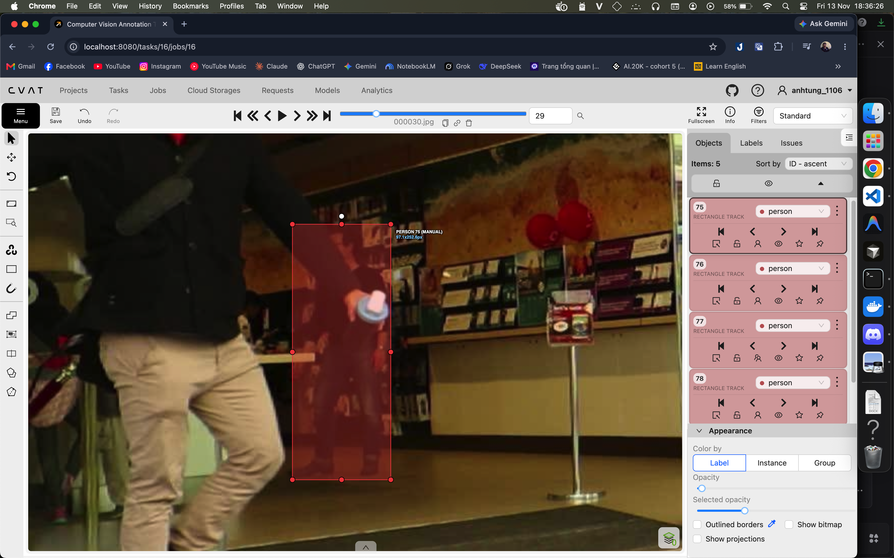
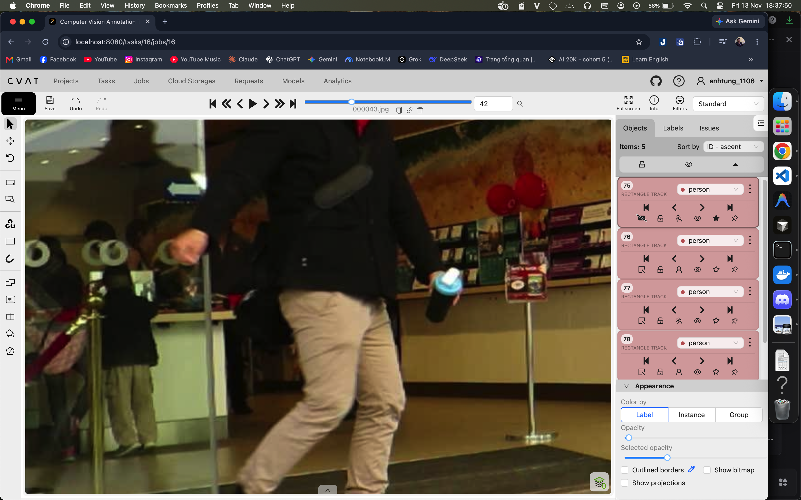
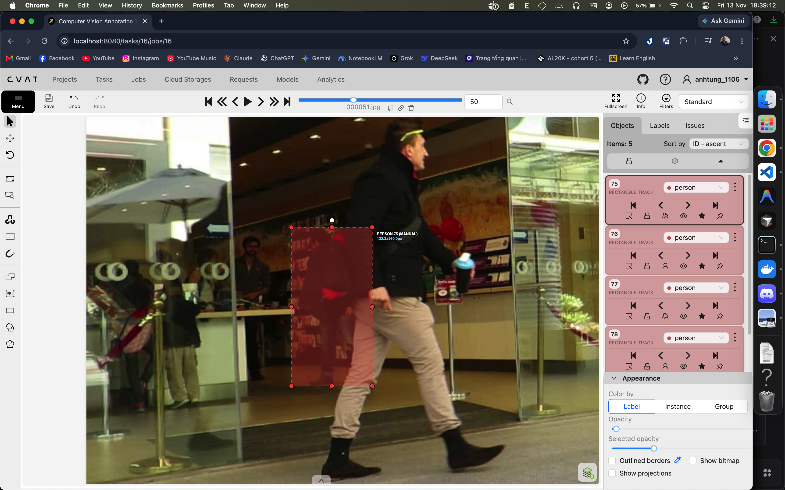

# Báo cáo cá nhân — Trần Anh Tùng — 2A202603280

Đoạn video: MOT17-09, 150 frame (frame 1–150), nguồn MOTChallenge, giấy phép CC BY-NC-SA 3.0.

## 0. Thông tin học viên

- Họ tên: Trần Anh Tùng
- MSSV: 2A202603280
- Mã đề (A/B/C): B
- Email: trantung110604@gmail.com
- Link repository: https://github.com/trananhtung1/K5-L2B-2A202603280-TranAnhTungMOTTracking
- Giờ bắt đầu: 16h30'
- Giờ kết thúc: 19h00'

## 1. Xem trước đoạn video (CP0)

Ghi **trước khi vẽ**, mỗi người một dòng.

| Mã | Frame xuất hiện | Frame cuối thấy được | Rẽ / dừng / đổi tốc độ ở frame | Bị che ở frame | Ghi chú |
|---|---|---|---|---|---|
| P1 | 0 | 149 | Không có | Che một phần 30–41; mất hẳn 42–49; hiện lại 50 | Thấy rõ hoàn toàn từ frame 60. |
| P2 | 0 | 149 | Không có | Không có | Thấy liên tục, di chuyển mượt. |
| P3 | 0 | 149 | Không có | Không có | 10 frame đầu chỉ thấy cánh tay, sau đó vào khung dần; đã nhận diện được đúng P3 từ frame 0. |
| P4 | 0 | 146 | Dừng ở 38; sau khi hiện lại di chuyển nhẹ đến 146 | Che một phần từ 106; mất hẳn 110–135; hiện lại 136 | Kiểm tra theo file xuất cuối. |
| P5 | 0 | 104 | Di chuyển đến 27, sau đó dừng | Che một phần từ 93; mất hẳn từ 105 đến hết đoạn | Không còn box từ frame 105. |

> Các số trong bảng là số frame CVAT (0–149), đã quy đổi từ ảnh nguồn 1–150.

## 2. Keyframe và thời gian (CP1, CP4)

Số keyframe lấy từ kết quả `src/check_submission.py`.

| Mã | Số keyframe | Keyframe ở frame | Số frame có mặt | Keyframe / 100 frame | Thời gian (phút) | Chỗ khó |
|---|---|---|---|---|---|---|
| P1 | 23 | 0, 10, 12, 19, 20, 24, 30, 40, 50, 56, 60, 70, 73, 78, 80, 90, 100, 110, 120, 130, 133, 140, 149 | 142 | 16.2 | 34 | Che một phần, mất hẳn rồi hiện lại cùng Track 0. |
| P2 | 34 | 0, 10, 20, 30, 40, 45, 47, 49, 50, 56, 57, 60, 63, 68, 70, 78, 80, 82, 90, 100, 106, 107, 110, 116, 120, 125, 130, 131, 133, 134, 140, 144, 146, 149 | 150 | 22.7 | 18 | Di chuyển liên tục; cần chỉnh box tại các điểm nội suy lệch. |
| P3 | 40 | 0, 10, 17, 19, 24, 30, 33, 35, 40, 44, 50, 52, 57, 59, 60, 62, 63, 64, 65, 66, 67, 68, 69, 70, 73, 80, 90, 93, 100, 110, 114, 120, 124, 130, 131, 133, 139, 140, 147, 149 | 150 | 26.7 | 18 | Vào khung dần ở đầu đoạn; cần nhiều keyframe khi rà box. |
| P4 | 17 | 0, 10, 17, 20, 30, 40, 50, 60, 80, 100, 106, 109, 136, 137, 139, 141, 146 | 121 | 14.0 | 31 | Che khuất, mất hẳn và xuất hiện lại. |
| P5 | 13 | 0, 10, 20, 30, 33, 40, 50, 60, 70, 80, 90, 93, 100 | 105 | 12.4 | 24 | Dừng sớm rồi bị che đến hết đoạn. |
| **Tổng** | **127** | — | **668** | **19.0** | **125** | |

Keyframe / 100 frame của cả bài = tổng keyframe ÷ tổng số frame có mặt × 100 = 127 ÷ 668 × 100 = **19.0**.

Bạn đặt keyframe nhiều nhất ở người nào? Vì sao (người đó rẽ, dừng, lại gần camera hay bị che)?

P3 có nhiều keyframe nhất (40) vì cần rà kỹ box ở giai đoạn đi vào khung và các điểm nội suy lệch.

## 3. Đoạn bị che (CP2)

Người bị che: `P1`

| Mốc | Frame |
|---|---:|
| Bắt đầu bị che một phần (bật `occluded`) | 30 |
| Mất hẳn (bật `outside`) | 42 |
| Hiện lại (tắt `outside`) | 50 |
| Thấy rõ trở lại (tắt `occluded`) | 60 |

- Thời gian khuất hẳn: 8 frame = 0.27 giây.
- Quyết định: giữ cùng ID.
- Lý do (trả lời 3 câu: khuất bao lâu so với 60 frame, ngoại hình có khớp, chỗ hiện lại có đúng hướng và tốc độ):

P1 khuất 8 frame, thấp hơn ngưỡng 60 frame. Khi hiện lại, track cũ được tiếp tục với cùng hướng chuyển động; giữ nguyên ID thay vì tạo track mới.

Ảnh chụp màn hình:





## 4. Tự review ID (CP3)

Lượt 1 theo người (đi ngược từ frame 149 về 0 trên CVAT), lượt 2 theo cảnh (nhảy 10 frame). Ít nhất 3 dòng; không có lỗi thì ghi một dòng "đã kiểm hai lượt, không lỗi".

Loại lỗi dùng đúng một trong 7 mã: `id_switch`, `fragmentation`, `lost`, `merge`, `false_track`, `drift`, `flag`.

| Frame | Mã người | Loại lỗi | Mô tả một câu | Phát hiện ở lượt | Đã sửa? |
|---:|---|---|---|---|---|
| 12 | P1 | `drift` | Box trôi khỏi toàn thân P1 do tay/chân vung nhanh. | Lượt 1 | Có |
| 19 | P1 | `drift` | Box trôi khỏi toàn thân P1 do tay/chân vung nhanh. | Lượt 1 | Có |
| 22 | P1 | `drift` | Box trôi khỏi toàn thân P1 do tay/chân vung nhanh. | Lượt 1 | Có |
| 24 | P1 | `drift` | Box trôi khỏi toàn thân P1 do tay/chân vung nhanh. | Lượt 1 | Có |
| 33 | P1 | `drift` | Box trôi khỏi toàn thân P1 do tay/chân vung nhanh. | Lượt 1 | Có |
| 38 | P1 | `drift` | Box trôi khỏi toàn thân P1 do tay/chân vung nhanh. | Lượt 1 | Có |
| 47 | P1 | `drift` | Box trôi khỏi toàn thân P1 do tay/chân vung nhanh. | Lượt 1 | Có |
| 56 | P1 | `drift` | Box trôi khỏi toàn thân P1 do tay/chân vung nhanh. | Lượt 1 | Có |
| 64 | P1 | `drift` | Box trôi khỏi toàn thân P1 do tay/chân vung nhanh. | Lượt 1 | Có |
| 68 | P1 | `drift` | Box trôi khỏi toàn thân P1 do tay/chân vung nhanh. | Lượt 1 | Có |
| 73 | P1 | `drift` | Box trôi khỏi toàn thân P1 do tay/chân vung nhanh. | Lượt 1 | Có |
| 78 | P1 | `drift` | Box trôi khỏi toàn thân P1 do tay/chân vung nhanh. | Lượt 1 | Có |
| 82 | P1 | `drift` | Box trôi khỏi toàn thân P1 do tay/chân vung nhanh. | Lượt 1 | Có |
| 53 | P1 | `flag` | Người qua đường che khuất hoàn toàn P1 nhưng cờ `outside` được bật muộn. | Lượt 1 | Có |
| 136 | P4 | `flag` | P4 (cô bé) xuất hiện lại muộn so với thực tế sau khi người qua đường đi qua. | Lượt 1 | Có |

Tổng hợp số lỗi theo loại:

| `id_switch` | `fragmentation` | `lost` | `merge` | `false_track` | `drift` | `flag` |
|---:|---:|---:|---:|---:|---:|---:|
| 0 | 0 | 0 | 0 | 0 | 13 | 2 |

Không có lỗi nào chỉ được phát hiện ở lượt 2. Toàn bộ 15 lỗi trên được phát hiện và sửa ở lượt 1 theo từng người; lượt 2 theo cảnh không còn phát hiện lỗi.

## 5. File xuất và kết quả tự kiểm (CP4)

| Kiểm tra | Kết quả |
|---|---|
| Tên file MOT 1.1 | `src/exports/TranAnhTung_mot.zip` |
| Tên file CVAT for video 1.1 | `src/exports/TranAnhTung_cvat_video.zip` |
| Số track ID khác nhau trong `gt/gt.txt` (phải là 5) | 5 |
| Frame `outside` không có dòng trong `gt.txt` (đúng / sai) | Đúng (P1: frame 42–49; P4: frame 110–135) |
| Job đã completed trên CVAT máy cá nhân | Đã completed. |

Dán phần tóm tắt in ra từ `src/check_submission.py`:

```text
=== File MOT 1.1: TranAnhTung_mot.zip ===
  Số track ID: 5   |   Tổng số box: 668
  [OK]        Đúng 5 track ID.

=== File CVAT for video 1.1: TranAnhTung_cvat_video.zip ===
  Tổng: 127 keyframe / 668 frame có mặt = 19.0 keyframe / 100 frame
  [OK]        Đọc được 5 track từ annotations.xml.

=== Tóm tắt ===
  Lỗi: 0   |   Cảnh báo: 0
  Đạt.
```

## 6. Ba câu kết

1. Nếu được gán lại, bạn sẽ đặt keyframe khác ở đâu? Vì sao?

Frame drift 38
P1 chuyển động tay và chân nhanh, nội suy tuyến tính làm box không còn ôm người; nếu làm lại, tôi sẽ chủ động đặt keyframe tại điểm đó thay vì đợi box trôi rồi mới sửa

2. Có chỗ nào bạn không chắc "cùng ID hay ID mới"? Bạn đã quyết định và ghi chú thế nào?

P1 mất hẳn frame 42–49, tức 8 frame
8 < 60 frame; khi hiện lại vẫn cùng người, cùng hướng di chuyển, nên tiếp tục Track cũ và giữ ID

3. Một lỗi ID trong job của bạn (nếu không còn sót, chọn lỗi đã sửa) có thể làm xe tự lái dự đoán sai chuyển động của người đó như thế nào? Lỗi đó ảnh hưởng MOTA hay IDF1 nhiều hơn?

Chọn lỗi drift

box lệch làm vị trí người bị sai, từ đó vận tốc/hướng dự đoán sai; xe có thể đánh giá khoảng cách hoặc thời điểm người đi bộ đi vào đường không chính xác

Nếu IoU giảm dưới ngưỡng ghép, lỗi này dễ gây FN/FP nên ảnh hưởng MOTA rõ hơn; nếu ID không đổi thì IDF1 ít bị ảnh hưởng hơn

## Bonus (nếu làm)

### B1 — Hai người đi sát

...

### B2 — So cách đặt keyframe

| Cách đặt | Số keyframe | Frame trôi nhất | Ghi chú |
|---|---:|---:|---|
| Đều mỗi 30 frame | | | |
| Theo chỗ đổi hướng | | | |

...

### B3 — So với tracker có sẵn

| Frame | Mã người | Tracker làm gì | Nhãn của bạn | Giải thích (đoán rồi sửa / ghép IoU / box score thấp / ngoại hình) |
|---:|---|---|---|---|
| | | | | |
| | | | | |

## 7. Tài liệu tham khảo và công cụ AI đã dùng

- MOT17, MOTChallenge (Milan et al., 2016), giấy phép CC BY-NC-SA 3.0.
- OpenAI Codex: dùng để hướng dẫn thao tác CVAT, giải thích khái niệm tracking và kiểm tra kết quả script; không dùng để tự động tạo box hoặc track ID.
